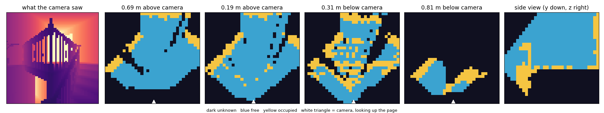
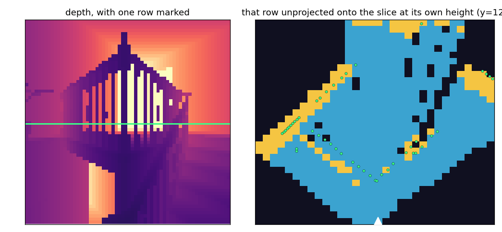
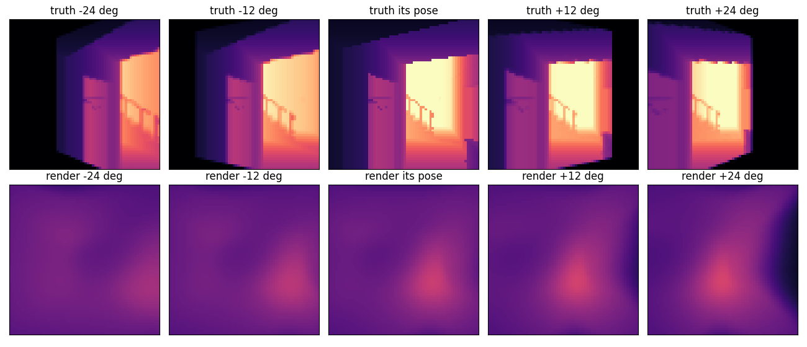

# VVAE

A visual encoder that turns a short burst of posed camera frames into a **3D belief about the space around the robot**, rather than a compressed picture. Only the encoder ships to the hexapod's Raspberry Pi; the decoder exists to train it and is thrown away.

The problem it solves: a camera reports surfaces, one flat image at a time. A robot needs to know where things *are* — including that it does not know what is behind the wall it can see.

## How it works

**1. Lift.** Each frame's depth places its pixels as points in a shared metric box (4 x 3 x 4 m, cut into 32 x 24 x 32 voxels of 12.5 cm). Poses are relative to the window's middle frame, so the box travels with the robot.

**2. Carve.** Depth also says which space is *empty*. Marching from the camera to each surface splits the box into three states, where a lift alone gives only two:



Horizontal slices at four heights through a stairwell, camera at bottom centre. **Blue is free** space a ray passed through, **yellow is occupied** where it stopped, and **dark is unknown** — behind a wall, under the stairs, or outside the view. Unknown is not empty, and keeping them apart is what lets the model decline to guess.

Each panel cuts one height, so a staircase looks different in every one. To tie a slice back to the picture, unproject a row of image pixels onto it:



The green line is one row of the depth image; the green dots are those same pixels placed in 3D. They land on the wall the carving found.

**3. Encode.** 3D convolutions compress the box to a latent of `[4, 8, 6, 8]` — 1536 numbers, one 50 cm voxel each, carrying mean and variance.

**4. Decode and render.** The latent is expanded back into a volume and rendered from a viewpoint **the encoder never saw**. Reconstructing the input frames would be satisfied by a latent that stores pictures; only a held-out viewpoint forces it to store a scene.



Truth on top, render below, as the query camera pans. A latent holding a scene changes with the viewpoint; one that has collapsed renders the same image across the row.

## Running it

```bash
# one run -- checkpoints land in .runs/, named after the flags that vary
uv run python -m hexai.models.vvae.train --jitter=1 --lr=0.003

# a sweep
uv run wandb sweep src/hexai/models/vvae/sweep.json
wandb agent <entity>/<project>/<sweep_id>

# continue a run without restarting its schedule, then anneal it out
uv run python -m hexai.models.vvae.train --resume .runs/<name>.pt --epochs 20
uv run python -m hexai.models.vvae.train --resume .runs/<name>.pt --epochs 20 --taper 1
```

`--jitter` aims the head each frame, which is what the pan/tilt servos do on the robot, and masks the loss over pixels no input frame saw.

### Reading the metrics

| | |
|---|---|
| `val/skill` | 0 is no better than predicting the average image, 1 is perfect. The scale for everything else |
| `val/lift_agreement` | does the decoded geometry match what was observed, over observed voxels only |
| `val/invented_density` | how much the decoder puts where no camera reached. Lower is better, but an empty volume wins it outright, so read it beside agreement |
| `val/scene_corr` | how alike different scenes decode. Near 1 means the decoder is ignoring its input |
| `val/depth_mae_m` | depth error in metres |

## Layout

```
geometry.py   lift, carve, render, camera intrinsics
model.py      VVAE (frame stack) and VVAEGeometric (this one)
data.py       TartanGround windows, context/target split, pose noise
train.py      training loop, metrics, figures
notebooks/    exploration
figures/      the images above
.runs/        checkpoints, gitignored
.agents/      why the design is this way, and what experiments showed
```

## For agents

Read **`.agents/`** before changing anything here.

- **`.agents/context.md`** — the design rationale. What the Pi budget and the camera geometry rule out, and why each structural choice was made rather than an alternative.
- **`.agents/learned.md`** — what runs actually showed, and the measurement traps that have already cost a run. Read it before touching the loss, the metrics, or a sweep config.
- **`.agents/todo.md`** — open tasks, and known limitations that already have a measurement attached.

Author: Marco Cassar (@Ocramaru)
